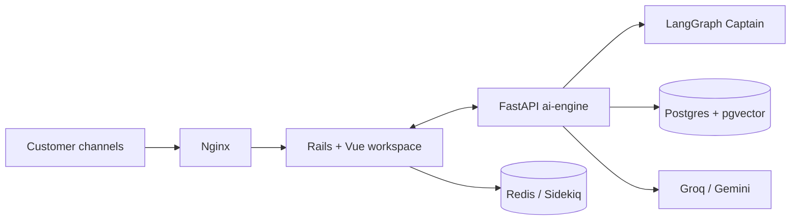

# OmniDesk AI

   

Open-source, self-hosted omnichannel AI support platform, modeled on Chatwoot, with agentic triage, hybrid RAG and CNN image inspection. This repo contains the **scroll-story landing site, a live Groq/Gemini AI gateway** and a **reference ai-engine + database stack**.

## Features
- Scroll-driven cinematic landing page (vanilla JS, no libraries)
- `/api/chat` and `/api/triage`: Groq first, Gemini fallback, **automatic model detection**, rules-based last resort
- Per-IP rate limiting, PII masking, untrusted-input prompt isolation
- `platform/`: FastAPI ai-engine (HMAC, injection guard, RRF merge, confidence handoff), Postgres 16 + pgvector with row-level security, Docker Compose

## Architecture


## Run locally
```
npm i -g vercel
cp .env.example .env   # add GROQ_API_KEY / GEMINI_API_KEY
vercel dev
```
Platform stack: `cd platform && docker compose up --build` (set `PG_PASSWORD`, `REDIS_PASSWORD`, `INTERNAL_HMAC_SECRET`).

## Deploy
Import the repo in Vercel, add the two API keys as environment variables, deploy, then open `/api/health`.

## Roadmap
Rails/Vue agent workspace, live retrieval wiring, ONNX CNN models, WhatsApp/Email connectors.

## Author
Nikhil Chary Sriramoju - [GitHub](https://github.com/Nikhil-creat) | [LinkedIn](https://in.linkedin.com/in/nikhil-chary-sriramoju-95041b38a) | sriramojunikhil66@gmail.com
